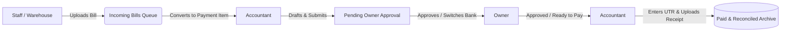

# INDFURN PayFlow — Payment Authorization & UTR Tracking System

A secure, mobile-first enterprise web application and Progressive Web App (PWA) engineered for **INDFURN** to digitize supplier invoice approvals, multi-bank payment authorizations, and post-payment UTR (Unique Transaction Reference) reconciliation.

Built with Next.js 15 (App Router, Server Actions), TypeScript, Tailwind CSS, shadcn/ui, and Supabase (PostgreSQL, Auth, Storage).

---

## 🚀 Key Highlights & Architecture

- **Role-Based Access Control (RBAC):** Three distinct operating tiers (`OWNER`, `ACCOUNTANT`, `STAFF`) with strict SSR route guards and PostgreSQL Row-Level Security (RLS).
- **Post-Approval Immutability:** Database triggers lock financial fields (`amount`, `vendor_id`, `invoice_ref`, `tds`, `source_bank_id`) immediately upon Owner approval.
- **Duplicate Prevention:**
  - Real-time client-side warning banner during draft payment creation.
  - Case-insensitive database unique index on trimmed UTR references (`idx_payment_items_unique_utr`).
- **Private Storage & 5-Minute Signed URLs:** Supplier bills and bank receipts are stored in private Supabase Storage buckets. File viewing uses short-lived, role-verified signed URLs—no file is ever made publicly accessible.
- **Physical A4 Print Replica:** Pixel-perfect A4 printable replica of INDFURN's physical *Payment Approval Form* with sign-off blocks (`Prepared By`, `Checked By`, `Approved By`).
- **CSV Formula Injection Protection:** Sanitizes exported spreadsheets against CWE-1236 injection attacks.
- **Installable PWA:** Network-first service worker that serves an offline fallback shell while strictly preventing stale cached financial balances.

---

## 👥 User Roles & Workflow



### 1. Stock / Warehouse Staff (`STAFF`)
- **Primary Route:** `/bills`
- **Mobile-First Upload:** Snap a photo or attach an invoice PDF (up to 5MB) on mobile, specify vendor, invoice/PI reference number, optional amount, and receiving notes.
- **Strict Isolation:** Stock staff are completely partitioned from company bank accounts, payment amounts, owner approval screens, and accountant ledgers.
- **Tracking:** Staff can view the status of their own uploads (*Waiting for Accountant* or *Added to Payment Queue*).

### 2. Accounts Team (`ACCOUNTANT`)
- **Primary Routes:** `/payments`, `/vendors`, `/history`
- **Payments Workspace:** Real-time ledger organized into 6 status tabs:
  - `Incoming Bills`: Queue of staff-uploaded invoices ready to convert into payment vouchers.
  - `Draft`: Working ledger with live TDS calculations and duplicate invoice warning checks.
  - `Pending`: Submitted to Owner for payment authorization.
  - `Ready to Pay`: Approved by Owner; awaiting bank execution.
  - `Paid`: Completed payments with verified UTR numbers and attached receipts.
  - `Rejected`: Payments rejected by Owner with feedback reasons.
- **UTR Reconciliation:** Uploads bank payment advice (Axis Bank or South Indian Bank), enters the UTR number, and archives the transaction.

### 3. Business Owner (`OWNER`)
- **Primary Routes:** `/approvals`, `/history`, `/settings`, `/vendors`
- **Daily Approvals Strip:** Compact top summary displaying total pending amount and automatic bank split (Axis vs. SIB).
- **1-Tap Authorization:** Approves payments with confirmation dialogs, holds payments for inquiry, or rejects payments with a mandatory reason.
- **Inline Bank Switcher:** Allows the Owner to re-route payments between bank accounts (e.g., Axis Bank ↔ South Indian Bank) with 1 tap prior to approval.
- **User & Bank Administration (`/settings`):** Manage company bank accounts and provision new team member accounts with activation toggles.

---

## 🛠️ Technology Stack

| Layer | Technology |
|---|---|
| **Framework** | [Next.js 15](https://nextjs.org/) (App Router, React 19, Server Actions) |
| **Language** | [TypeScript](https://www.typescriptlang.org/) (Strict mode, zero `any`) |
| **Styling** | [Tailwind CSS](https://tailwindcss.com/) with custom slate light-mode palette |
| **UI Components** | [shadcn/ui](https://ui.shadcn.com/) (Radix UI primitives, Lucide icons, Sonner) |
| **Database & Auth** | [Supabase](https://supabase.com/) (PostgreSQL 15+, Supabase SSR Auth, Private Storage) |
| **PWA** | Web App Manifest, Service Worker (`sw.js`), Apple Web App tags |
| **Validation** | [Zod](https://zod.dev/) safe parsing on all client inputs & Server Actions |

---

## 🔒 Security Architecture

1. **Row-Level Security (RLS):** Every PostgreSQL table (`profiles`, `vendors`, `company_banks`, `incoming_bills`, `payment_items`, `audit_logs`) has granular RLS policies.
2. **Server-Side Verification:** Server actions re-verify user role and active status (`is_active === true`) directly from PostgreSQL, independent of JWT claims.
3. **Database Integrity Triggers:**
   - `trg_enforce_payment_integrity`: Restricts `DELETE` operations strictly to `DRAFT` status; prevents changes to financial parameters post-approval.
   - `trg_audit_payment_items`: Automatically writes change deltas to the immutable `audit_logs` table upon status transitions.
4. **Service Role Isolation:** The `SUPABASE_SERVICE_ROLE_KEY` is strictly confined to server-only code ([src/lib/supabase/admin.ts](src/lib/supabase/admin.ts)) for user management and is never exposed in client bundles.

---

## 📦 Local Development Setup

### Prerequisites
- Node.js 18.18+ or 20+
- npm (or pnpm/yarn)
- A Supabase Project ([supabase.com](https://supabase.com))

### 1. Clone the Repository
```bash
git clone https://github.com/muhammed-shimlal/Payment-Approval-System-.git
cd Payment-Approval-System-
```

### 2. Install Dependencies
```bash
npm install
```

### 3. Configure Environment Variables
Copy the example environment template:
```bash
cp .env.example .env.local
```
Fill in your Supabase credentials in `.env.local`:
```env
NEXT_PUBLIC_SUPABASE_URL=https://your-project-id.supabase.co
NEXT_PUBLIC_SUPABASE_ANON_KEY=your-supabase-anon-key
SUPABASE_SERVICE_ROLE_KEY=your-supabase-service-role-key
```

### 4. Apply Database Migrations
In your Supabase project's **SQL Editor**, run the entire schema migration script:
```text
supabase/migrations/001_initial_schema.sql
```
This script creates:
- Tables: `profiles`, `company_banks`, `vendors`, `incoming_bills`, `payment_items`, `audit_logs`
- Indexes: Performance indexes on dates, vendors, and the unique UTR index
- Triggers: Integrity constraints and audit trails
- Row-Level Security: Comprehensive RLS policies for each role
- Default banks: Axis Bank and South Indian Bank (SIB)

### 5. Create Supabase Storage Buckets
In the Supabase Dashboard under **Storage**, create two **Private** buckets (toggle *Public bucket* to **OFF**):
1. `supplier-invoices` (Max file size: 5MB; Allowed MIME types: `application/pdf`, `image/*`)
2. `bank-receipts` (Max file size: 5MB; Allowed MIME types: `application/pdf`, `image/*`)

### 6. Create the Initial Owner Account
Create an initial user in Supabase Auth via Dashboard or SQL, then ensure a matching profile exists in `public.profiles`:
```sql
INSERT INTO public.profiles (id, full_name, role, is_active)
VALUES ('<AUTH_USER_UUID>', 'Primary Owner', 'OWNER', true);
```

### 7. Run the Development Server
```bash
npm run dev
```
Open [http://localhost:3000](http://localhost:3000) in your browser.

---

## 🧪 Production Verification

To verify the TypeScript types and build an optimized production bundle:

```bash
# 1. Typecheck
npx tsc --noEmit

# 2. Production Build
npm run build

# 3. Start Production Server
npm run start
```

---

## 📄 License
Proprietary software developed for **INDFURN**. All rights reserved.
